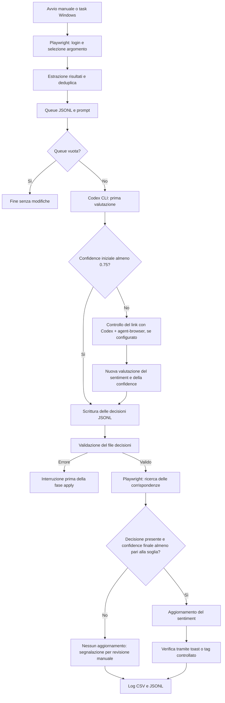

# LinkMonitor · Automazione del sentiment

Automazione di un flusso di media monitoring: raccoglie le menzioni presenti in LinkMonitor, affida a Codex CLI la valutazione del sentiment e riporta nell'interfaccia le decisioni che superano una soglia di confidenza.

Il progetto nasce da un'attività ripetitiva: aprire ogni risultato, valutarne l'impatto sul brand e aggiornare il sentiment a mano. La parte interessante non è soltanto automatizzare i clic, ma collegare una valutazione interpretativa a un'applicazione web, mantenendo decisioni consultabili e un percorso per i casi incerti.

Questo repository raccoglie il codice operativo e la documentazione per presentarlo in un colloquio. Gli esempi sono inventati; credenziali, log di produzione, screenshot e documenti interni non sono inclusi. La configurazione e il prompt nel codice conservano il caso d'uso originale, relativo a brand del settore betting.

**Stack:** Python, Playwright con Chromium, Codex CLI, PowerShell e Utilità di pianificazione di Windows.

## Il confine tra browser e classificazione

Lo script Python non sceglie il sentiment e non contiene un classificatore locale. Non effettua chiamate dirette alle API OpenAI. Si occupa dell'estrazione e dell'applicazione; la classificazione avviene tramite Codex CLI, invocato dal launcher PowerShell.

Questa separazione permette di leggere le decisioni prima di applicarle, ripetere una fase e diagnosticare un problema senza confondere la valutazione del contenuto con l'interazione con il sito. Codex rimane un servizio esterno: richiede autenticazione, accesso a un modello disponibile e connessione di rete.



Il controllo del link avviene durante la classificazione Codex, prima della scrittura delle decisioni. Se la confidence finale rimane sotto soglia, oppure manca una decisione corrispondente, la fase di applicazione lascia il risultato invariato e lo segnala per revisione manuale. Il prompt richiede il controllo del contenuto; l'uso di `agent-browser` dipende dalla configurazione della sessione Codex e non è imposto dai launcher di questo repository.

## Come funziona una singola esecuzione

### 1. Accesso e preparazione della pagina

Il bot apre Chromium, raggiunge l'URL Analytics configurato e completa il login quando necessario. Gestisce anche schermate che separano email e password. Poi apre la sezione **Risultati**, seleziona l'argomento e rimuove alcune selezioni predefinite previste dal caso d'uso originale.

La pagina è una SPA. Il codice combina selettori semantici, ricerche nel DOM e fallback per interagire con elementi che non sono sempre esposti nello stesso modo. L'argomento è configurabile; i fallback e le deselezioni specifiche restano legati all'interfaccia per cui il bot è stato sviluppato.

### 2. Estrazione dei risultati

La lista viene percorsa con scroll progressivo. Le righe possono comparire e scomparire dal DOM: per questo i risultati vengono raccolti in una mappa, deduplicati e ordinati secondo la posizione stimata nella lista.

Per gli URL il bot dà priorità al permalink associato alla pubblicazione, poi al link principale e infine a un link esterno di fallback. Questo riduce il rischio di usare il profilo di un social al posto del singolo post. Le menzioni già segnate come `controllato` vengono escluse, salvo `--force-update`.

Il risultato è `logs/codex_review_queue.jsonl`: una riga JSON per menzione, con titolo, URL, snippet, testo della riga e metadati di estrazione. Il bot genera anche `logs/codex_sentiment_prompt.md`.

### 3. Valutazione con Codex CLI

Il launcher passa a `codex.cmd exec` il prompt e l'intera queue tramite standard input. Codex deve produrre soltanto `logs/codex_decisions.jsonl`, senza eseguire il bot né aggiornare LinkMonitor.

Il prompt chiede di valutare l'impatto reputazionale sul brand, non soltanto il tono linguistico. Ammette tre valori: `positivo`, `neutro` e `negativo`. Quando la prima valutazione non raggiunge `0.75`, chiede a Codex di aprire il link, verificarne il contenuto e rivalutare sentiment e confidence prima di scrivere la decisione finale. Con `agent-browser` configurato nella sessione Codex, questo approfondimento può avvenire tramite browser; l'effettiva possibilità di aprire il contenuto dipende dagli strumenti e dai permessi disponibili. Se l'incertezza rimane dopo il controllo, Codex deve lasciare la confidence sotto soglia: il bot registra il caso per revisione manuale e non aggiorna il risultato.

```json
{"url":"https://example.invalid/iniziativa-sociale","title":"Brand demo presenta una nuova iniziativa sociale","sentiment":"positivo","confidence":0.86,"reason":"Esempio fittizio: contenuto favorevole al brand."}
```

La `confidence` è una stima del modello: non è una probabilità calibrata né una misura di accuratezza verificata. Serve come criterio operativo per rinviare i casi incerti alla revisione.

### 4. Validazione e applicazione

Prima dell'apply, il launcher controlla che il file esista, che contenga tante righe quante la queue, che ogni riga sia JSON valido e che siano presenti i campi richiesti. Verifica anche i valori del sentiment e la conversione numerica della confidence. Se questi controlli falliscono, interrompe il flusso.

Il bot riapre LinkMonitor e cerca la decisione corrispondente tramite URL o titolo normalizzati. Le righe già controllate vengono saltate; quelle prive di una decisione o sotto `CONFIDENCE_THRESHOLD` vengono registrate per revisione. Per le altre apre il menu, seleziona il sentiment e cerca un toast di conferma oppure il tag `controllato`.

Ogni esito viene scritto nei log. Un apply senza risultati, con errori, decisioni mancanti o casi da revisionare restituisce un codice di uscita non zero. Gli aggiornamenti precedenti a un errore restano applicati: il flusso non è una transazione e non dispone di rollback.

## File del repository

| File | Ruolo |
| --- | --- |
| `linkmonitor_sentiment_bot.py` | Login, navigazione, estrazione, lettura decisioni, aggiornamento e log |
| `run_linkmonitor_daily.ps1` | Flusso completo in produzione: extract → Codex → validazione → apply |
| `run_linkmonitor_test20.ps1` | Lo stesso flusso su un numero limitato di link, con opzione dry-run |
| `install_linkmonitor_daily_task.ps1` | Registrazione del task giornaliero Windows |
| `requirements.txt` | Dipendenze Python: Playwright e python-dotenv |
| `.env.example` | Configurazione di esempio senza credenziali reali |
| `.gitignore` | Esclusione di credenziali, output operativi e ambienti locali |
| `examples/` | Queue e decisioni fittizie per leggere il formato senza accedere al servizio |

## Installazione su Windows

Il flusso completo utilizza Windows PowerShell, Python e la distribuzione npm di Codex CLI, perché i launcher cercano `codex.cmd`. Python 3.12 è una scelta adatta al codice presente. Servono inoltre un account LinkMonitor autorizzato e una sessione Codex autenticata con accesso al modello configurato.

Da PowerShell, nella cartella del repository:

```powershell
python -m venv .venv
.\.venv\Scripts\python.exe -m pip install -r requirements.txt
.\.venv\Scripts\python.exe -m playwright install chromium
Copy-Item .env.example .env
```

I comandi usano direttamente Python dell'ambiente virtuale, senza richiedere l'attivazione tramite script. Installare poi Codex CLI con Node.js/npm e completare l'autenticazione:

```powershell
npm.cmd install -g @openai/codex
codex.cmd login
```

I launcher impostano `gpt-6-luna` con reasoning effort `high`, come nella configurazione operativa originale. Se il modello non è disponibile nel proprio account, occorre modificare il valore di `--model` in entrambi i launcher prima di eseguirli. Configurazione, strumenti e permessi Codex del computer di origine non sono distribuiti in questo repository.

Le istruzioni di installazione di [Playwright](https://playwright.dev/python/docs/library) e [Codex CLI](https://developers.openai.com/codex/cli) sono documentate dai rispettivi progetti.

### Configurazione

Aprire `.env` e inserire email, password e URL Analytics completo del proprio account. L'URL di esempio non identifica un progetto utilizzabile: va sostituito, conservando eventuali frammenti `#` nell'URL reale.

| Variabile | Uso |
| --- | --- |
| `LINKMONITOR_EMAIL`, `LINKMONITOR_PASSWORD` | Credenziali dell'account |
| `LINKMONITOR_URL` | URL della pagina Analytics del progetto |
| `TOPIC_NAME` | Argomento da selezionare nella barra laterale |
| `CONFIDENCE_THRESHOLD` | Soglia per applicare una decisione; valore predefinito `0.75` |
| `HEADLESS` | Browser senza finestra; i flag CLI possono cambiare la modalità |
| `MAX_LINKS` | Limite predefinito; `--production` lo rimuove |
| `FORCE_UPDATE` | Include anche le righe già controllate |
| `DRY_RUN` | Simula l'aggiornamento senza cliccare sul sentiment |
| `NAVIGATION_TIMEOUT_MS` | Timeout Playwright; valore predefinito `45000` |
| `SLOW_MO_MS` | Rallentamento delle operazioni browser per debug |
| `CODEX_QUEUE_FILE`, `CODEX_DECISIONS_FILE` | Percorsi per l'uso diretto del bot |

I launcher assumono i percorsi standard sotto `logs/`: per usarli non cambiare le ultime due variabili. Il prompt contiene un elenco di brand del caso d'uso originale, indipendente da `TOPIC_NAME`; per un altro progetto va adattata anche la funzione `write_codex_prompt()`.

## Primo controllo: flusso completo in dry-run

```powershell
powershell -NoProfile -ExecutionPolicy Bypass -File .\run_linkmonitor_test20.ps1 -MaxLinks 5 -DryRun
```

Il browser resta visibile. Il comando effettua login, estrae dati reali e usa Codex per classificarli, ma non modifica il sentiment. Il dry-run richiede comunque gli account e usa il servizio Codex; può terminare con errore se trova casi da revisionare. Per eseguirlo senza finestra, aggiungere `-Headless`.

Per applicare realmente le decisioni su cinque link:

```powershell
powershell -NoProfile -ExecutionPolicy Bypass -File .\run_linkmonitor_test20.ps1 -MaxLinks 5
```

`run_linkmonitor_test20.ps1` usa 20 link quando `-MaxLinks` non viene specificato. La versione senza `-DryRun` modifica i risultati sul servizio.

## Esecuzione manuale delle singole fasi

È possibile controllare queue e decisioni tra un passaggio e l'altro.

**Estrazione su cinque link:**

```powershell
.\.venv\Scripts\python.exe .\linkmonitor_sentiment_bot.py --extract-for-codex --test --headed
```

**Classificazione:** avviare `codex.cmd` nella cartella del repository e chiedere di leggere `logs/codex_sentiment_prompt.md` e `logs/codex_review_queue.jsonl`, quindi creare `logs/codex_decisions.jsonl` secondo lo schema indicato. Leggere il file prima del passo successivo.

**Simulazione dell'applicazione:**

```powershell
.\.venv\Scripts\python.exe .\linkmonitor_sentiment_bot.py --apply-decisions --test --headed --dry-run
```

**Applicazione reale:**

```powershell
.\.venv\Scripts\python.exe .\linkmonitor_sentiment_bot.py --apply-decisions --test --headed
```

La validazione aggiuntiva del numero di righe è eseguita dai launcher PowerShell. Nell'uso manuale, il bot valida e carica le decisioni, ma non esegue tutti gli stessi controlli preliminari del launcher.

## Produzione e pianificazione giornaliera

Il launcher giornaliero lavora su tutti i risultati disponibili, in headless:

```powershell
powershell -NoProfile -ExecutionPolicy Bypass -File .\run_linkmonitor_daily.ps1
```

Prima dell'esecuzione archivia la queue precedente e il file decisioni, poi rimuove quest'ultimo per evitare di riutilizzare decisioni di una sessione precedente. Se la nuova queue è vuota, termina senza invocare Codex né eseguire l'apply.

Per registrare il task alle 12:00:

```powershell
powershell -NoProfile -ExecutionPolicy Bypass -File .\install_linkmonitor_daily_task.ps1 -At "12:00"
```

Lo script crea o aggiorna il task **LinkMonitor Sentiment Daily** per l'utente corrente. Impedisce esecuzioni sovrapposte, consente il recupero di un avvio mancato e imposta un limite di sei ore. Usa `LogonType Interactive`: l'utente deve essere connesso e il PC operativo. Il task non rende il flusso indipendente dal computer locale.

## Output e diagnosi

| Percorso generato | Contenuto |
| --- | --- |
| `logs/codex_review_queue.jsonl` | Menzioni estratte per la classificazione |
| `logs/codex_sentiment_prompt.md` | Istruzioni e criteri reputazionali |
| `logs/codex_decisions.jsonl` | Sentiment, confidence e motivazione |
| `logs/run_log.csv`, `logs/run_log.jsonl` | Esito di ogni riga elaborata |
| `logs/review_needed.csv` | Decisioni sotto soglia o mancanti |
| `logs/automation_*.log`, `logs/test20_*.log` | Transcript dei launcher |
| `logs/*codex_last_message_*.txt` | Ultimo messaggio della sessione Codex |
| `logs/automation_archive/` | Queue e decisioni delle sessioni precedenti |
| `logs/debug_*`, `screenshots_errors/` | Diagnostica della pagina e degli errori |

Nei log di applicazione, `success` indica una conferma rilevata nell'interfaccia; `dry_run` indica una simulazione; `skipped_already_checked` una riga saltata. Gli stati `review_needed`, `no_codex_decision` e `fail` richiedono attenzione prima di ripetere l'esecuzione.

I file di diagnostica possono contenere dati del progetto e schermate dell'account. `.gitignore` li esclude insieme a `.env`; anche eventuali esportazioni manuali devono essere controllate prima della pubblicazione. Il codice non stampa intenzionalmente la password nei messaggi di log, ma screenshot e dump della pagina richiedono comunque cautela.

## Esempi consultabili senza account

La cartella `examples/` contiene due menzioni inventate e le relative decisioni. I domini `example.invalid` non rimandano a contenuti reali. Una decisione ha confidence `0.86`, l'altra `0.54`: con soglia `0.75`, la seconda richiederebbe revisione.

Dopo aver installato le dipendenze Python, si può verificare il caricamento senza aprire browser né usare Codex:

```powershell
.\.venv\Scripts\python.exe -c "from pathlib import Path; from linkmonitor_sentiment_bot import load_decisions; decisions = load_decisions(Path('examples/codex_decisions.jsonl')); print([(d.sentiment, d.confidence) for d in {d.url: d for d in decisions.values()}.values()])"
```

Questo controllo mostra soltanto il parsing delle decisioni. Non simula LinkMonitor e non dimostra la qualità della classificazione.

## Scelte tecniche da discutere in colloquio

- **Automazione dell'interfaccia:** Playwright permette di lavorare sul flusso disponibile via browser, ma richiede manutenzione quando il sito cambia.
- **Fasi separate e file intermedi:** queue e decisioni rendono ispezionabile il passaggio fra estrazione, interpretazione e scrittura.
- **Liste dinamiche:** deduplica, scroll progressivo e permalink affrontano problemi concreti di risultati virtualizzati e contenuti social.
- **Gestione dell'incertezza:** le decisioni sotto soglia vengono rinviate alla revisione, evitando di forzare ogni menzione in un aggiornamento automatico.
- **Controllo operativo:** archivi, transcript, codici di uscita e verifica del salvataggio aiutano a distinguere un avvio del processo da un lavoro completato.

## Limiti e possibili sviluppi

Il bot dipende da selettori, struttura della pagina, menu e colori dell'interfaccia LinkMonitor. La ricerca tramite titolo e URL normalizzati non garantisce identificatori univoci; inoltre la verifica tramite tag `controllato` non prova da sola che il sentiment finale sia quello richiesto.

La validazione del launcher controlla forma e numero delle decisioni, ma non dimostra una corrispondenza uno a uno con la queue né impone l'intervallo `[0, 1]` alla confidence. Anche i contenuti passati al modello devono essere trattati come dati esterni: le istruzioni nel prompt e la sandbox non costituiscono una protezione completa dalle istruzioni ostili presenti nei contenuti.

Il repository non include un benchmark di accuratezza, una stima misurata del risparmio di tempo, test end-to-end pubblici o una configurazione Docker. Il collaudo del flusso reale richiede accesso autorizzato al servizio. Le dipendenze sono definite per intervalli di versione, non tramite lockfile: l'installazione non è perfettamente riproducibile.

Gli sviluppi più utili sarebbero identificatori stabili per collegare queue e decisioni, controlli di schema più rigorosi, verifica esplicita del sentiment salvato e un insieme di menzioni annotate per misurare gli errori del modello. Un runner portabile e Docker diventerebbero utili per trasferire il flusso su un server sempre acceso.

Questo è un progetto indipendente: il repository non distribuisce account, dati dei clienti né componenti proprietari del servizio LinkMonitor.
